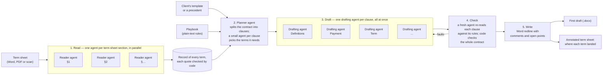

# Contract drafting engine

An agentic engine that turns an agreed term sheet into a first-draft contract. It works from
the client's own template, or from a precedent (a signed contract from an earlier deal), and
writes the draft as a Word redline. Every change is a tracked change, and every open point is a
Word comment that gives its reason. The lawyer reviews the draft instead of writing it.

It is a first draft for lawyer review, never a finished contract.

## How it works



**Headline figures**

| | |
|---|---|
| Agents in a full draft | One per term-sheet section, one planner, one per clause: tens working at once |
| Time for a full 150-page contract | About 20–25 minutes |
| Output | A Word redline: every change tracked, with a comment where the reason needs explaining; every point it cannot settle raised as an open question |
| Coverage check | An annotated term sheet naming the clause that carries each item |
| Tested on | Drafting from a template and from a precedent; Word, PDF and scanned term sheets |

1. **Read.** A model proposes the term sheet's headings, and code cuts the sections by
   position. Then one reader agent per section records every term, each with a verbatim quote.
   Code checks every quote against the term sheet, and the reader can't finish while a sentence
   with a figure or defined term is still unaccounted for. Output: `record.json`.
2. **Plan.** A planner agent splits the base document into pieces (a clause, a block of
   definitions, a schedule) and gives each piece its playbook section. Code checks that every
   line is in exactly one piece and that every section name is real. A small agent per piece
   then picks the term sheet sections that piece needs, and each term that several pieces read
   gets one owner, so nothing is written twice.
3. **Draft.** One drafting agent per piece, all running at once, longest first. Each works in a
   loop: read paragraphs by id, edit, read back. It has to account for every playbook rule
   before it can submit. A fresh read then checks the piece against its rules once more.
4. **Check the whole contract.** Code finds what only the whole document shows: a definition
   nobody uses any more, a term defined twice, a paragraph struck with no reason. Each is sent
   back to the piece that holds it.
5. **Write.** The final paragraphs go into a clean copy of the base. A document compare then
   marks it up against the base, the way Word's own Compare does. Tables, numbering, footnotes
   and cross-reference fields survive. Comments are attached to the paragraphs they're about.

Two principles:
- **Code checks structure, agents make drafting decisions.** No phrase lists, no regex that
  decides content.
- **The playbook is plain text a lawyer can edit** (`playbooks/`). It isn't code. Improving the
  drafts mostly means improving the playbook.

The annotated term sheet (`annotate`) is the term sheet itself, with a note after each item
naming the clause that carries it. That lets the reviewer check coverage item by item.

## Click-through demo (no setup)

Open `demo/index.html` in any browser, or host that one file anywhere (GitHub Pages, any
static site) and share the link. It needs no model key and no server, and works
offline. It replays a saved run: the term sheet, the agents at work, the redline with its
comments, and the annotated term sheet, with the Word files to download.

It replays two saved runs on the same deal, one from the template and one from the client's last signed NDA (`examples/nda/precedent.docx`). To rebuild it: `.venv/bin/python examples/build_replay.py`; the runs it reads are listed in `RUNS` at the bottom of that script.
(the run folder needs `record.json`, `plan.json`, `edits.json`, `draft.docx`,
`annotated-termsheet.docx` and `run.log`).

## Five-minute demo (a live run)

You need Python 3.12+ and access to a model that supports tool calling.

```bash
python -m venv .venv && .venv/bin/pip install -e . pytest
cp .env.example .env          # then fill in one provider
.venv/bin/python examples/make_demo.py

.venv/bin/drafting-engine read examples/nda/termsheet.docx --out runs/demo \
    --playbook playbooks/example-nda/nda.md
.venv/bin/drafting-engine draft runs/demo --base examples/nda/template.docx \
    --playbook playbooks/example-nda/nda.md --client-details examples/nda/client-details.json \
    --deal-facts examples/nda/deal-facts.json
.venv/bin/drafting-engine annotate runs/demo --termsheet examples/nda/termsheet.docx
```

Open `runs/demo/draft.docx` in Word and look at the tracked changes and comments. The demo's
documents are made up.

To test without a model, run `.venv/bin/pytest`. The end-to-end test drives the whole pipeline
with a scripted stand-in model and checks the redline it writes.

## Configuration (`.env`)

| Variable | Meaning |
|---|---|
| `DRAFTING_AZURE_OPENAI_ENDPOINT`, `_DEPLOYMENT`, `_API_VERSION`, `_API_KEY` | Azure OpenAI. Leave the key blank to sign in with Azure credentials |
| `OPENAI_API_KEY`, `DRAFTING_MODEL` | The OpenAI API, used when no Azure endpoint is set |
| `DRAFTING_LLM_TOKENS_PER_MINUTE` | This process's share of the model's rate limit. Calls wait instead of failing. 0 means no limit |
| `DRAFTING_LLM_CONCURRENCY` | The most model calls in flight at once. 0 means no limit |
| `DRAFTING_REASONING_EFFORT` | Default `none`. Reasoning models need it to call tools on chat completions |

Speed and cost depend on the model, the contract's length and the rate limit: a long contract
is tens of pieces and tens of millions of tokens. Set the workers and the token cap for your
deployment, and measure on a demo run before quoting a time or a cost.

## Layout

```
src/drafting_engine/
  termsheet/   reading the term sheet: sections, reader agents, the record
  draft/       planner, drafting agent, whole-contract checks, writer, run loop,
               annotated term sheet, version compare
  draft/briefs/  the agents' briefs (prompts), as Markdown a lawyer can read
  word/        the Word layer: rendering, numbering, quote matching
  llm/         the model client, its rate limiter, the agent loop
  cli.py
playbooks/     general.md (the base every client playbook includes) and an example
examples/      the demo's made-up documents
docs/          the playbook guide and the new-client guide
```

## Starting with a new client

Read `docs/new-client-guide.md`, then `docs/playbook-guide.md`. In short: collect the client's
templates and some past term sheets, write a playbook on top of `playbooks/general.md`, draft,
have a lawyer review the draft, and turn every comment into a playbook rule. Repeat until the
lawyer's comments stop being about substance.

## Status and limits

Tested on the model, on invented documents:
- drafting from the client's template (the demo), and from a precedent (`--precedent`), where the
  old deal's parties, purpose, figures and law were replaced and its extras flagged for the lawyer;
- Word term sheets, PDF term sheets, and a scanned PDF with no text layer (read by OCR, which
  needs `pdftoppm` and `tesseract`);
- drafting only some clauses (`--only`), the annotated term sheet, and `compare`.

- Gates: the offline pipeline test and the unit tests (`pytest`), and ruff. mypy is not a gate
  yet: the drafting modules are not typed to mypy's standard.
- The Word layer was built and hardened on long, heavily numbered contracts. Expect new edge
  cases on new template families, and fix them in `draft/writer.py` with a test.
- Drafting isn't deterministic (reasoning models accept no temperature). Judge a playbook change
  on two runs, not one.
- Client clause libraries and a hosted service are not part of this engine.

## Third-party components

`adeu` (MIT) renders and edits Word documents. `docx-redline` (MPL-2.0) writes the compared
redline. Both are installed as dependencies, not copied in.
