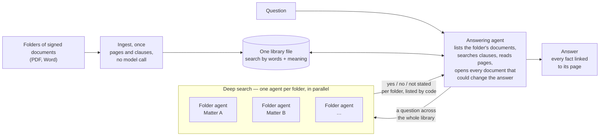

# Document search engine

Ask questions of a fixed library of contracts and get answers that cite the exact page. The agent
reads every document that could have changed a term (an amendment, a novation, a termination)
before it answers.

## How it works



**Headline figures**

| | |
|---|---|
| Accuracy on the checked questions | 13 of 13 right, each citing the right page, with search by words and with search by meaning |
| What the questions test | A term's current value after an amendment; an agreement ended by a termination and replaced the same day; a supplier changed by novation; a side letter in a Word file; a question across the whole library |
| Agents | One answering agent; for a question across the library, one agent per folder in parallel |
| Ingest | No model call: reading a library costs nothing but time |

1. **Ingest, once.** Each folder of the library is read into pages and clauses and indexed by
   words and, with `EMBEDDING_MODEL` set, by meaning. No model reads the documents at ingest and
   nothing is extracted from them.
2. **Ask.** An agent answers with tools over the stored pages: a folder's documents (each with
   its opening lines), clause search, a clause by number, pages by number, and a deep search that
   reads every folder by itself for a question across the library.
3. **Read before answering.** The brief makes the agent open every document that could have
   changed a term (an amendment, a novation, a termination, a replacement) before it gives the
   term's current value, and cite the page of each fact.

## Click-through demo (no setup)

Open `demo/index.html` in any browser, or host that one file on any static site. It needs no
model key and no server. Pick a question to replay the engine's real answer, open any citation at
its page, and see the conversations kept under Recent chats. Rebuild it from a new run with
`.venv/bin/python examples/build_replay.py`.

## Try it

```bash
python -m venv .venv && .venv/bin/pip install -e . reportlab pytest
cp .env.example .env                       # one model provider
.venv/bin/python examples/make_library.py  # three folders of made-up documents
.venv/bin/document-search ingest examples/library --db runs/library.db
.venv/bin/document-search ask "What rent is payable now under the Harbour Street lease?" --db runs/library.db
.venv/bin/document-search eval examples/questions.json --db runs/library.db
```

`eval` asks every question in `examples/questions.json` and marks each right only where the answer
states the expected value and cites the expected page. On the demo library: 13 of 13 right,
with search by words alone and with search by meaning.
`pytest` runs the offline tests, with no model.

## Your own library

See `docs/starting-a-project.md` for the step-by-step.


Put each matter (or client, or asset) in its own folder of PDFs, Word or text files, run
`ingest`, and write a questions file with answers a lawyer has checked. PDFs give page links;
A Word file has no pages until printed, so it is read as one page. Re-running `ingest`
reads only new or changed files.

## Configuration (`.env`)

| Variable | Meaning |
|---|---|
| `AZURE_OPENAI_ENDPOINT`, `_DEPLOYMENT`, `_API_VERSION`, `_API_KEY` | Azure OpenAI. Leave the key blank for Azure sign-in |
| `OPENAI_API_KEY`, `OPENAI_MODEL` | The OpenAI API, used when no Azure endpoint is set |
| `EMBEDDING_MODEL` | Adds search by meaning to search by words (tested with `text-embedding-3-large`) |
| `SEARCH_LLM_CONCURRENCY` | Model calls in flight at once, shared by every answer (default 4) |
| `SEARCH_LINK_BASE` | What citation links start with (default `library/`) |

## Limits

- Tested on a small made-up library. A real library needs its own checked questions before its
  answers are trusted, and a lawyer reads the answers.
- Clauses are found by their numbering; a document with no numbered clauses is searched by page.
- Scanned PDFs with no text layer need OCR before ingest.
- Deep search is tested on three folders. It asks every folder, four model calls at a time, so
  on hundreds of folders it takes minutes, and it has no overall time limit.
